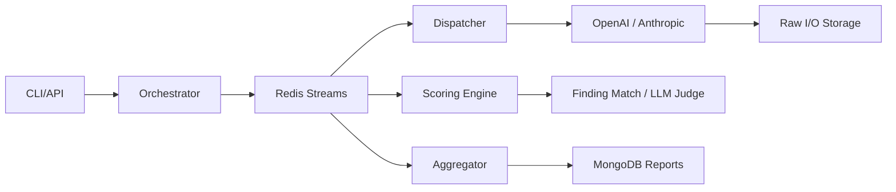

# AgentBench

**Benchmark AI code-review agents against versioned, reproducible test cases — and re-score any past run under a new rubric without paying for a single new API call.**

[](https://www.python.org/downloads/)
[](LICENSE)
[](https://github.com/aluiziolira/agentbench-ai-evaluation/actions/workflows/ci.yml)


*Demo recorded with [VHS](https://github.com/charmbracelet/vhs) ([`docs/demo.tape`](docs/demo.tape)) against mocked LLM adapters: the full pipeline — Redis Streams orchestration, deterministic + LLM-judge scoring, MongoDB reports, stored-output re-scoring — runs for real; only the provider API calls are stubbed, so the demo is reproducible offline at zero API cost.*

AgentBench runs AI agents (Claude, GPT) against seeded PR-review cases, scores their findings with both deterministic matching and an LLM judge, and produces comparative benchmark reports over an event-driven pipeline.

**At a glance**

| | |
|---|---|
| **Pipeline** | Event-driven: Redis Streams orchestration, MongoDB reports, raw I/O archive |
| **Scoring** | Deterministic `finding_match` + rubric-configurable `llm_judge` |
| **Reproducibility** | 8 versioned fixture cases; stored outputs re-scorable offline at zero cost |
| **Quality bar** | 462 unit tests in ~5s, 1.6:1 test-to-source ratio, `mypy --strict`, ruff, CI + secret scanning |

## The Problem

Evaluating AI agents against each other is harder than it sounds. Most evaluation setups pull inputs from live sources: real GitHub pull requests, scraped Jira tickets, or provider-specific data feeds. That creates a comparability problem:

- **Scores drift** — when inputs change between runs, you can't tell whether the agent improved or the data did.
- **Results can't be compared** — different teams pulling from different providers produce numbers that don't line up.
- **Iteration costs money** — re-scoring under a new rubric means re-invoking the agent, because the raw output was never stored.

The result is benchmarks that look precise but can't be reproduced, compared, or iterated on without spending more API credits.

AgentBench solves this by **fixing the inputs and storing the outputs**. Every benchmark case is a committed fixture — a ticket, a diff, and a ground-truth file that never changes unless the case set is explicitly versioned. Every agent response is persisted as raw I/O, so re-scoring costs nothing. Every agent runs against the same workflow and case set, making cross-agent comparison a direct measurement rather than an approximation.

**Deliberately out of scope:** AgentBench is not a production PR-review bot, a GitHub App, a Jira integration, or a platform for evaluating agents against live repositories. It does not apply patches, run test suites, or execute the code under review. Fixing the benchmark to a single workflow and a versioned case set is a design choice, not a missing feature.

## Results

Sample run on 8 PR-review cases (E2E validated 2026-04-04; scores from the LLM-judged `s2_review_summary` step):

| Agent | Avg Score | P50 Latency | P95 Latency | Failure Rate |
|-------|-----------|-------------|-------------|--------------|
| **claude-haiku-4-5** | **0.913** | 2,500ms | 5,000ms | 0.0% |
| **gpt-4o-mini** | **0.888** | 1,500ms | 7,500ms | 0.0% |

- Claude Haiku scored highest (91.3%), 2.8% ahead of GPT-4o-mini
- GPT-4o-mini was faster on P50 latency (1.5s vs 2.5s)
- Both agents completed all runs with a 0% failure rate

<details>
<summary><strong>Per-case breakdown</strong></summary>

| Case | Claude Haiku | GPT-4o-mini | Topic |
|------|--------------|-------------|-------|
| pr_006_state_consistency_bug | **0.96** | 0.92 | Caching/State |
| pr_001_missing_auth_check | 0.92 | 0.92 | Auth/Security |
| pr_002_missing_test_coverage | 0.92 | **0.92** | Testing |
| pr_007_missing_validation | **0.92** | 0.88 | Input Validation |
| pr_008_performance_regression | **0.92** | 0.88 | Database/N+1 |
| pr_003_missing_null_guard | **0.90** | 0.82 | Null Safety |
| pr_004_contract_breaking_change | 0.88 | **0.88** | API Compatibility |
| pr_005_missing_error_handling | 0.88 | **0.88** | Error Handling |

</details>

Run your own comparison:

```bash
just demo        # Full demo with both agents
# Or for a custom comparison:
# uv run python -m cli.main run \
#   --workflow wf_pr_review_v1 \
#   --case-set pr_review_cases_v1 \
#   --agents gpt-4o-mini --agents claude-haiku-4-5
```

## Architecture



Each component is a deliberately simplified stand-in for its production counterpart:

| Component | Simplified Version | Production Analogue |
|-----------|-------------------|---------------------|
| Redis Streams | Single Redis instance | Kafka / RabbitMQ |
| MongoDB | Single node | MongoDB Atlas / replicaset |
| Object Storage | Local filesystem | S3 / GCS |
| Single Process | Asyncio tasks | Kubernetes / ECS |
| In-memory scoring | Pydantic models | Dedicated scoring service |

## Design Decisions

**Event-driven orchestration over direct calls.** Every step transition routes through Redis Streams instead of synchronous function calls. For a single-user evaluation tool, direct calls would work fine — the trade-off accepted here is more event choreography (producers, consumer groups, event schemas that must stay aligned) in exchange for hard service boundaries. Dispatch, scoring, and aggregation all react to the same event bus and hold no references to each other, mirroring production message-bus architectures. Swapping a scoring strategy or adding an aggregation step means wiring a new consumer, not refactoring the orchestrator's control flow.

**Split storage: MongoDB for reports, filesystem for raw I/O.** A single store would be simpler to set up, but would make re-scoring expensive or reports hard to query. MongoDB holds benchmark metadata, scores, and per-case breakdowns with typed Pydantic validation and index-backed queries; raw prompt/response pairs live as files the scoring engine reads directly. Any stored run can be re-scored under a new rubric without re-invoking the agent, and every scoring decision traces back to the exact inputs that produced it.

**Two scoring strategies for two different questions.** `finding_match` compares agent findings against ground truth with deterministic label matching — reproducible baselines with no stochastic resampling. `llm_judge` sends the full review to another LLM for qualitative assessment under a configurable rubric — nuance that string matching can't capture.

**Reliability and correctness details baked in:**

- Explicit per-request timeouts with provider-error normalization on every adapter call
- Fail-fast run isolation — a single failed run never stalls a benchmark
- Idempotent report persistence guarded by unique MongoDB indexes
- Explicit index setup on query-heavy collections
- Async service composition for non-blocking orchestration
- `mypy --strict` typing and ruff lint/format enforced in CI

## Why Seeded Fixtures?

The alternative is live ingestion — pulling PRs and tickets from GitHub, Jira, or GitLab at runtime. That introduces non-determinism, rate limits, auth complexity, and privacy risk. Seeded fixtures eliminate all four while keeping the evaluation grounded in realistic review scenarios:

| Seeded Fixtures | Live Ingestion |
|-----------------|----------------|
| Reproducible | Non-deterministic |
| Stable scoring | Score drift over time |
| No API rate limits | Rate limited |
| Works offline | Requires connectivity |
| No auth complexity | OAuth/App setup |
| Clear demo assets | Privacy concerns |

## Sample Case Walkthrough

### Case: PR-002 Missing Test Coverage

**Ticket:**
```markdown
# PR-002: Implement order discount calculator

Add a new `DiscountCalculator` service that handles various discount
rules for orders, including percentage discounts, fixed amount discounts,
and tiered discounts based on order value.
```

**Diff excerpt:**
```python
# app/services/discount.py (88 lines added)
def calculate_discount(order, discount_code):
    # Implementation without tests
    if discount_code.type == "percentage":
        return order.total * (discount_code.value / 100)
    elif discount_code.type == "fixed":
        return discount_code.value
    # ... more logic
```

**Ground-truth expected finding:**
- **Issue**: Missing unit tests for discount calculations
- **Severity**: High
- **File**: `app/services/discount.py`
- **Line span**: 1-88

**Claude Haiku response (s1_findings):**
```json
{
  "findings": [
    {
      "canonical_label": "missing_input_validation",
      "severity": "high",
      "file_path": "app/api/admin.py",
      "title": "Missing input validation for date range and status filters",
      "why_it_matters": "Without validation, malformed date inputs could cause crashes or SQL injection vulnerabilities.",
      "suggested_test": "Test with invalid date formats, null values, extremely large date ranges."
    }
  ]
}
```

**GPT-4o-mini response (s1_findings):**
```json
{
  "findings": [
    {
      "canonical_label": "MISSING_TESTS",
      "severity": "high",
      "file_path": "app/services/discount.py",
      "title": "Missing unit tests for discount calculations",
      "why_it_matters": "Without unit tests, there is no assurance that calculations work correctly.",
      "suggested_test": "Add unit tests for each type of discount and their combinations."
    }
  ]
}
```

**Review summary (Claude Haiku s2_review_summary):**
> The implementation is missing comprehensive unit tests for the discount
> calculation logic, particularly around edge cases for tiered discounts and
> discount code validation. The service lacks input validation on the
> `calculate_discount` function which could lead to runtime errors with
> malformed discount codes. Add thorough test coverage including edge cases
> for percentage calculations (e.g., 0%, 100%), invalid discount codes, and
> boundary conditions for tiered discount thresholds before merging.

Note the divergence: Haiku's structured `s1_findings` misses the seeded finding while GPT-4o-mini nails it, yet both score 0.92 on this case — the headline scores come from the LLM-judged `s2_review_summary` step, and Haiku's summary does cover the missing tests. Capturing both steps is exactly why the framework stores every intermediate output rather than just a final number.

## Re-Scoring Stored Runs

AgentBench re-scores stored outputs without re-invoking agents:

```bash
# Re-score a summary with a different rubric
uv run python -m cli.main rescore \
  --run-id {run_id} \
  --step s2_review_summary \
  --strategy llm_judge \
  --rubric "Prioritize production risk above all else"
```

The command prints a compact score summary (with per-dimension judge scores when available); pass `--json` for the full `StepScore` payload.

**Why this matters:**
- Deterministic `finding_match` scores remain stable
- LLM-judged scores change when the rubric changes
- Scoring criteria become something you can experiment with
- Re-scoring costs zero additional API credits

## Five-Minute Local Run

Requires Python 3.12+, Docker, and API keys (OpenAI + Anthropic).

```bash
git clone https://github.com/aluiziolira/agentbench-ai-evaluation.git
cd agentbench-ai-evaluation
pip install uv && uv sync
cp .env.example .env          # Add OPENAI_API_KEY and ANTHROPIC_API_KEY

# Bootstrap: start infrastructure, seed database
just init

# Start all services in dev mode (foreground with logs)
just dev

# In another terminal, run the demo (auto-starts benchmark + watches with visuals)
just demo        # Full benchmark (~3 min, 2 agents, 8 cases)
just demo-quick  # Fast run (~1.5 min, 1 agent, 8 cases)
```

The CLI includes an enhanced demo mode with visual highlights for performance grading, score progress bars, and latency metrics. View existing benchmarks with:

```bash
# View completed benchmark with demo visuals
uv run python -m cli.main report {benchmark_id} --demo

# Static report without per-case breakdown (concise)
uv run python -m cli.main report {benchmark_id} --demo --no-per-case
```

## Testing

| Suite | Command | Time | Dependencies |
|-------|---------|------|--------------|
| Unit | `just test-unit` | ~5s | None (all mocked) |
| Coverage | `just coverage` | ~10s | None |
| Full check | `just check` | ~15s | Lint + typecheck + tests |
| CI quality gate | `just ci-pr` | ~20s | Same as CI pipeline |

**Unit tests** mock all external dependencies and run in ~5 seconds (462 tests). Coverage spans adapters, storage, orchestration, scoring, API, CLI, and workflow validation — the test suite is larger than the source it covers (1.6:1 by line count).

```bash
just test-unit                # All unit tests (fast)
just coverage                 # With coverage report
just check                    # Full quality gate (lint + typecheck + tests)
just test tests/unit/test_adapters.py -v  # Single module with verbosity
```

**Integration tests** make real API calls to OpenAI and Anthropic (~$0.50–1.00 per run), so they never run automatically in CI. They are gated behind `AGENTBENCH_INTEGRATION_TEST=1` and triggered manually — via the GitHub Actions "Integration" workflow (Actions → Integration → Run workflow) or locally:

```bash
# Start infrastructure and services (background mode)
just init && just services-bg

# Run integration tests (manual only - costs money)
AGENTBENCH_INTEGRATION_TEST=1 just test-integration
```

Integration tests validate multi-agent pipeline completion, single-agent execution, and artifact storage.

## CI/CD

Task automation runs through [Just](https://just.systems), and GitHub Actions runs the same recipes in CI — `just ci-pr` locally executes the identical quality gate that gates every PR:

- **Secret scanning** — gitleaks detects potential secrets in the codebase
- **Quality gate** — lint (ruff), type check (`mypy --strict`), and unit tests via `just ci-pr`

The `.github/actions/setup-agentbench` composite action encapsulates setup (just, Python, uv, caching, dependency sync) so every workflow stays consistent.

## API Endpoints

| Endpoint | Method | Description |
|----------|--------|-------------|
| `/health` | GET | Health check |
| `/benchmarks` | POST | Create benchmark |
| `/benchmarks/{id}` | GET | Get report |
| `/benchmarks/{id}/runs` | GET | List runs |

## License

MIT License - See [LICENSE](LICENSE) for details.
